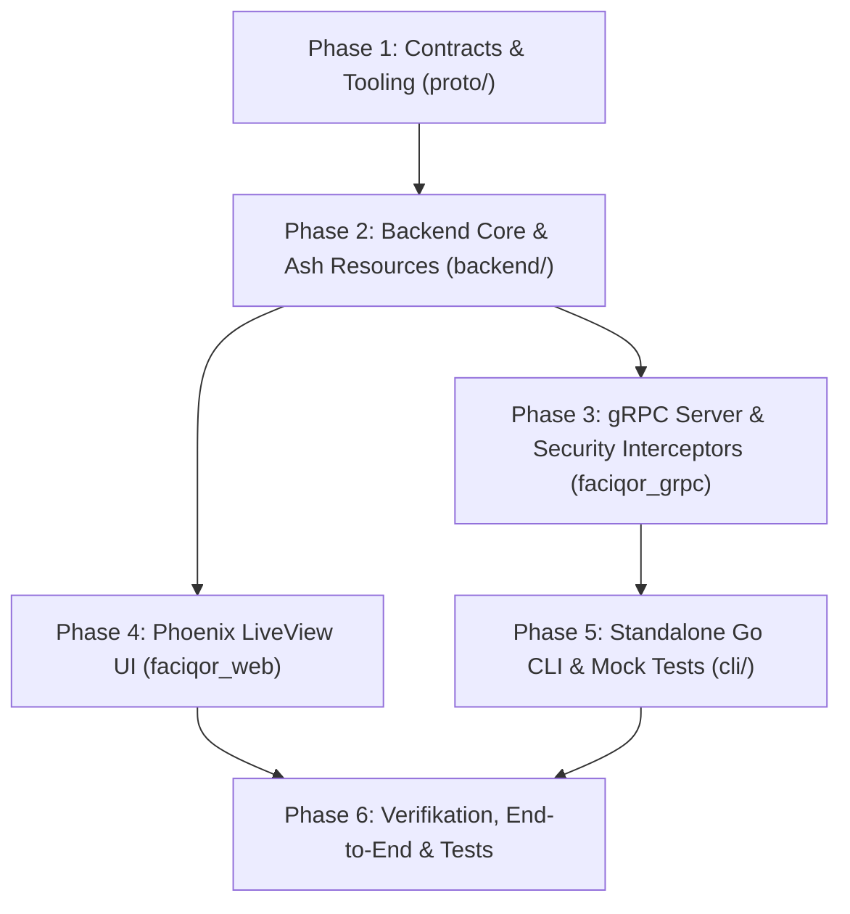

# Umsetzungsplan: Meilenstein 1 – Identity, Profile & Organization Boilerplate

> **Dokument-ID:** PLAN-M1-BOILERPLATE  
> **Status:** Abgeschlossen (Alle Phasen P1–P6 umgesetzt)  
> **Referenzen:**  
> - Anforderungsspezifikation: [001-milrestone.md](file:///S:/src/faciqor/docs/requirements/001-milrestone.md)  
> - Architektur & Layout: [architecture_and_projectfolder_layout.md](file:///S:/src/faciqor/docs/architecture_and_projectfolder_layout.md)  
> - Agentenregeln: [AGENTS.md](file:///S:/src/faciqor/AGENTS.md)  
> - Design Tokens: [tokens.json](file:///S:/src/faciqor/design/tokens.json)  
> - Faciqor CSS: [app.css](file:///S:/src/faciqor/backend/assets/css/app.css)

---

## 1. Übersicht & Zielbild

Meilenstein 1 implementiert das technische und domänenspezifische Fundament von Faciqor:
1. **Contract-First API-Definition:** Protobuf-Vertrag `proto/faciqor/v1/identity.proto` für Profil- und Organisationsverwaltung sowie `buf.yaml` / `buf.gen.yaml`.
2. **Backend-Initialisierung & Domäne (`backend/`):**
   - Elixir / Phoenix / Ash 3.x Projekt-Setup inklusive AshPostgres, AshAuthentication, AshOban.
   - Domänenressourcen in `Faciqor.Accounts`: `User`, `Token`, `UserIdentity`, `ApiToken`, `Organization`, `OrganizationMembership`.
   - Geschäftslogik: Auto-Handle-Generierung, 14-Tage-Grace-Period für E-Mail-Verifizierung, 60-Tage-Soft-Delete mit Kaskadierung auf verwaiste Organisationen, Oban-Purge-Cronjob.
3. **gRPC-Server (`faciqor_grpc`):** Authentifizierungs-Interceptor mit PAT-Hashing, E-Mail-Verifizierungs-Gate und Fehler-Mapping auf gRPC-Statuscodes.
4. **Faciqor Hub Web-UI (`faciqor_web`):**
   - Phoenix LiveView Ansichten (`/sign-in`, `/register`, `/dashboard`, `/settings/profile`, `/orgs/new`, `/orgs/:handle/settings`, `/account/restore`, `/verify-email-required`).
   - Strikte Nutzung von `FaciqorWeb.CoreComponents`, den Design Tokens (`design/tokens.json`) und den CSS-Variablen `--fq-*`.
   - GoBD-konforme Readonly-Felder für schreibgeschützte Ansichten.
5. **Standalone Go-CLI (`cli/`):**
   - Cobra / Viper CLI-Architektur (`faciqor auth`, `faciqor profile`, `faciqor org`).
   - Volle JSON-Unterstützung (`--json`) und Unit-Tests mit gemocktem gRPC-Client.

---

## 2. Detaillierte Phasen & Arbeitspakete

### Phase 1: Contracts & Protobuf Workspace (`proto/`)
- [x] **P1.1 `proto/faciqor/v1/identity.proto` erstellen:**
  - Enums: `OrganizationFocus`, `MembershipRole`.
  - Service: `IdentityService` mit Methoden `GetMyProfile`, `UpdateMyProfile`, `RequestAccountDeletion`, `CreateOrganization`, `ListMyOrganizations`, `GetOrganization`, `UpdateOrganization`, `SoftDeleteOrganization`.
  - Messages gemäß Abschnitt 5.1 in `001-milrestone.md`.
- [x] **P1.2 Workspace-Konfiguration:**
  - `buf.yaml` und `buf.gen.yaml` im Root erstellen/konfigurieren für Elixir (`protoc-gen-elixir` / `grpc`) und Go (`protoc-gen-go`, `protoc-gen-go-grpc`).
  - Makefile-Targets (`make proto`) anlegen.

### Phase 2: Backend-Initialisierung & Domäne (`backend/`)
- [x] **P2.1 Elixir/Phoenix Projektinitialisierung:**
  - `mix.exs` anlegen mit Abhängigkeiten: `phoenix`, `phoenix_live_view`, `ash`, `ash_postgres`, `ash_authentication`, `ash_authentication_phoenix`, `ash_oban`, `grpc`, `protobuf`, `citext`.
  - Konfiguration in `config/config.exs`, `config/dev.exs`, `config/test.exs` und `config/runtime.exs`.
- [x] **P2.2 Datenbank-Migrationen:**
  - Aktivierung der PostgreSQL-Extension `citext`.
  - Migrationen für `users`, `user_tokens`, `user_identities`, `api_tokens`, `organizations`, `organization_memberships`.
  - Unique-Constraints und RLS-Vorbereitung.
- [x] **P2.3 Ash-Domäne `Faciqor.Accounts` & Ressourcen:**
  - `Faciqor.Accounts.User`: Attribute, Calculations (`email_verified?`, `verification_grace_expired?`, `purge_at`), Policies, `AshAuthentication` (Passwort, Magic Link, Google OAuth Vorbereitung).
  - `Faciqor.Accounts.Changes.GenerateDefaultHandle`: Automatische Fallback-Generierung bei Neuregistrierung.
  - `Faciqor.Accounts.Token` & `Faciqor.Accounts.UserIdentity`: Hilfsressourcen für Magic Links und OAuth2.
  - `Faciqor.Accounts.ApiToken`: PAT-Erstellung, Hashing (SHA-256), Validierung.
  - `Faciqor.Accounts.Organization`: Attribute (inkl. `primary_focus`), Validierung, Policies für M:N.
  - `Faciqor.Accounts.OrganizationMembership`: M:N-Zuordnung mit Rollen `:owner`, `:member`, `:guest`.
- [x] **P2.4 Lifecycle-Logik & Oban Jobs:**
  - Soft-Delete Kaskadierung auf Organisationen, bei denen der User der letzte `:owner` ist.
  - 60-Tage Wiederherstellungs-Aktion (`restore_user`).
  - `AshOban` Worker (`Faciqor.Accounts.Workers.PurgeDeletedAccounts`) für täglichen Hard-Delete nach Ablauf von 60 Tagen.

### Phase 3: gRPC Server & Schnittstellen-Adapter (`backend/lib/faciqor_grpc/`)
- [x] **P3.1 gRPC Endpoint & Interceptors:**
  - `FaciqorGrpc.Endpoint`: gRPC Server auf Port 50051.
  - `FaciqorGrpc.Interceptors.Auth`: PAT-Validierung, Extraktion von `authorization: Bearer fq_pat_...`, Setzen des Ash `actor`.
  - E-Mail-Verifizierungs-Gate: Abbruch mit `PERMISSION_DENIED`, falls `email_confirmed_at == nil`.
- [x] **P3.2 Service-Implementierung `FaciqorGrpc.Services.IdentityService`:**
  - Implementierung aller RPCs aus `identity.proto` mit Delegation auf `Faciqor.Accounts`.
  - Fehlerübersetzer von Ash-Fehlern (`Invalid`, `Forbidden`, `NotFound`) auf gRPC Statuscodes.

### Phase 4: Faciqor Hub Web-UI (`backend/lib/faciqor_web/`)
- [x] **P4.1 Core Components & Layouts:**
  - `FaciqorWeb.CoreComponents`: Inputs mit `readonly`-Styling, Monospace-Formatierung, Buttons mit Focus-Ring, Badges (`--fq-betrkv-*`, Status).
  - App-Shell mit permanentem 14-Tage-Verifizierungsbanner für unbestätigte Nutzer.
  - Multi-Tenant-Switcher im Header/Sidebar.
- [x] **P4.2 Authentifizierungs- & Onboarding-LiveViews:**
  - `/sign-in` & `/register`: Identifier-First Auth-Card (Google Button, Tabs für Magic Link und Passwort).
  - `/verify-email-required`: Sperransicht nach Ablauf der 14 Tage Grace Period via `on_mount` Hook.
  - `/account/restore`: Wiederherstellungsdialog bei Login gelöschter Konten innerhalb der 60 Tage Frist.
- [x] **P4.3 Hauptansichten & Dashboards:**
  - `/dashboard`: Empty-State mit Cards *"Erste Organisation gründen"* und *"Profil & CLI einrichten"*, bzw. Organisationsübersicht.
  - `/settings/profile`: Profilkarte mit Live-Validierung des Handles, Personal Access Tokens Karte mit PAT-Generierung, Gefahrenzone für Soft-Delete mit Liste betroffener verwaister Organisationen.
  - `/orgs/new`: 1-Schritt-Gründungsdialog mit Radio-Cards für `primary_focus`.
  - `/orgs/:handle/settings`: Rollenbasierte Formularansicht (Owner editierbar, Member/Guest mit GoBD-Readonly).

### Phase 5: Standalone Go CLI (`cli/`)
- [x] **P5.1 CLI-Basis & Konfiguration:**
  - `go.mod` initialisieren (`faciqor`).
  - Cobra Root-Command, Global Flags (`--json`, `--endpoint`), Viper-Konfiguration (`~/.config/faciqor/config.yaml`).
- [x] **P5.2 Subcommands:**
  - `faciqor auth`: `login`, `status`, `logout`.
  - `faciqor profile`: `show`, `update`, `delete`.
  - `faciqor org`: `list`, `create`, `show`, `update`, `delete`.
- [x] **P5.3 gRPC Client & Mocks:**
  - Client-Adapter für TLS/Insecure Verbindung und Token-Injektion.
  - Mock-Implementierung des `IdentityServiceClient` für isolierte Go CLI-Unit-Tests.

### Phase 6: Qualitätssicherung & Definition of Done
- [x] **P6.1 Backend- & Policy-Tests (`mix test`):**
  - Multi-Auth & Account Linking Tests.
  - Handle Auto-Generierung & Kollisionsbehandlung.
  - 14-Tage Verifizierungs-Gate & Calculations.
  - M:N Organisations-Autorisierung und Kaskadierender 60-Tage Soft-Delete.
  - LiveView-Tests für Onboarding, Grace Period Redirects und Readonly-Zustände.
- [x] **P6.2 CLI-Tests (`go test ./...`):**
  - Unit-Tests aller CLI-Befehle mit gemocktem gRPC-Client und Validierung der JSON-Ausgabe.
- [x] **P6.3 Code-Style & Linter:**
  - `mix format --check-formatted`, `mix compile --warnings-as-errors`.
  - `go vet ./...`.
